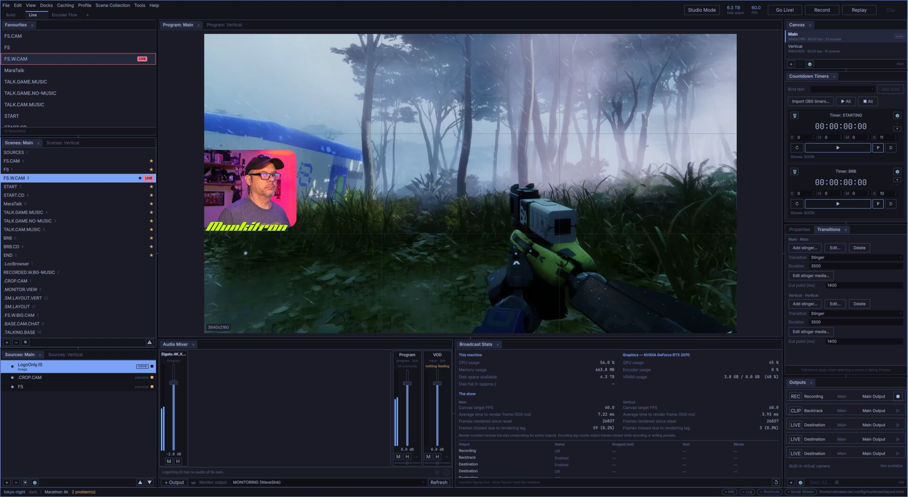
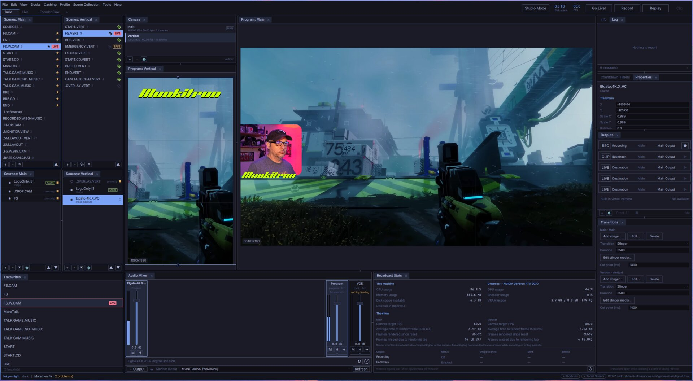
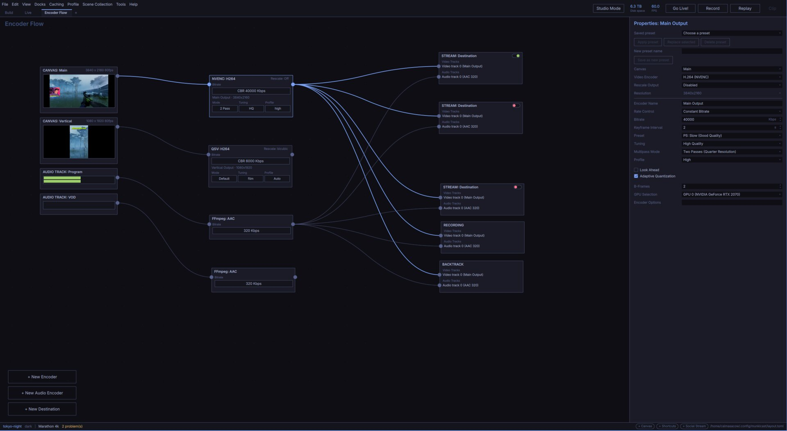

<!--
SPDX-FileCopyrightText: MunkiCast contributors
SPDX-License-Identifier: GPL-3.0-or-later
-->
# MunkiCast

A live streaming and recording studio for Linux, built clean-sheet. Omarchy (Arch + Hyprland) is the
bedrock target; the rest of Linux follows, then macOS and Windows.



**Status: pre-alpha.** H.264/AAC streaming to one RTMP/RTMPS destination, MKV recording,
replay buffering, Studio Mode, Companion control, and an independent native MCP server are
available. See [current status](docs/current_goal.md) and the [remaining work](docs/todo.md).

What exists is a workspace you can use and a document you can edit:

- **`munkicast-ui`** — one window holding the whole workspace, with Adobe-style drop-zone docking,
  dividers, tab groups, live Omarchy theme following, and a layout that survives being saved and
  restored at any resolution.
<table>
<tr>
<td><a href="docs/screenshots/build.jpg"></a><br><b>Build</b>: both canvases, scenes and sources</td>
<td><a href="docs/screenshots/encoder-flow.jpg"></a><br><b>Encoder Flow</b>: canvases wired to encoders and outputs</td>
</tr>
</table>

- **Saved workspaces** — `Build`, `Live`, and the `Encoder Flow` graph across the top, plus any you add. Building a show and
  running one want different panels up; these are arrangements of the one surface, never OS
  windows. The built-in pair can be rearranged and reset but not renamed away, so there is always
  a known arrangement to get back to.
- **A document model** — scenes as trees, groups, independent canvases with scene links, buses,
  decks, encodes, outputs, and filter stacks. Every panel in the workspace drives it: scenes, sources,
  properties, the audio mixer, and program/preview with the output list.
- **A command bus** — document edits use validated, journaled, undoable
  commands. A dragged fader is one undo step, not four hundred. Unsaved work survives the process
  being killed.
- **A project on disk** — a git-diffable directory of JSON, saved as a transaction. A corrupt scene
  costs one scene, not the collection.
- **Keyboard and hotkeys** — configurable application shortcuts and keyboard workspace navigation.
  Tab reaches every input (number fields, dropdowns, checkboxes, colour swatches, mixer faders,
  the source list), and each takes the expected keys; the focused control shows an accent outline.
  System-wide portal registration remains pending; a global scope in the table does not mean
  that the shortcut works while another application has focus.
- **Projectors** — Program or Preview, windowed, fullscreen, or fullscreen on a chosen screen, from
  the canvas's context menu. The render process presents them directly from the GPU.
- **Machine telemetry** — CPU, memory, free disk, and GPU, VRAM and *encoder* load read live from
  NVML, plus actual renderer and active output statistics. Unavailable metrics display "—".

The program canvas is published by `munkicast-render`, which also owns capture and encoding.
With no render process running, the canvas reads "no pipeline attached".

## Testing basic RTMP

1. Open **Encode**. Connect a canvas to an H.264 video encoder, a Program bus to an AAC
   audio encoder, and both encoders to a streaming destination. Choose x264 for software encoding
   or NVENC when supported by the installed GPU and driver. On NVIDIA, NVENC reads the canvas
   from GPU memory (NV12 converted on the GPU, shared through CUDA external memory) with no
   system-RAM readback; x264, other vendors and odd canvas sizes use the host path.
2. Choose a destination type. Services provide their ingest servers; choose **RTMP** for a
   custom server URL, for example `rtmp://server/live`.
   Enter the stream key separately; leaving the field saves it to the keyring.
   **Save key to keyring** also saves or retries a failed save. This requires `secret-tool`
   (Arch: `libsecret`) and an unlocked Secret Service keyring. An empty key reference publishes
   directly to the URL, useful for local servers without authentication.
3. Arm exactly one streaming destination. **Go Live!** enables once its URL and routes are valid.
   It shows **Connecting…** while opening, then **Stop Live** after the server accepts publishing.
4. Check video and audio at the receiver. Click **Stop Live** to finish.

Twitch and YouTube support account authorization; see [destination and OAuth setup](docs/connectors.md).

Streaming and recording can run together when connected to the same video and audio encodes.
The encode runs once; each destination starts and stops independently. Destination connection or
write failures report an error while the other destination continues. Reconnect manually with
**Go Live!**. RTMPS uses FFmpeg's installed TLS support. Separate concurrent encodes, multistreaming,
automatic reconnect, and streaming after closing the app remain pending.

New video capture sources default to **Match incoming signal** for resolution and frame rate.
This requires the device to report its incoming timing. Studio selects a capture rate within
0.5% of that signal and follows timing changes. If detection is unavailable, select an explicit
mode; Studio reports the limitation rather than guessing. **Use current device mode** preserves
the existing USB capture settings. Existing saved sources keep their selected modes.

## Replay / Backtrack

The Backtrack node buffers its connected video/audio encode in RAM. Select it, then enable
**Replay Buffer** in its Properties panel. This enables the **Replay** toolbar button without
starting buffering. Click **Replay** to start or stop the buffer. Defaults: **20s**, **512MB**. Stop buffering to edit either
integer limit with the field's up/down arrows. The same compressed encode feeds replay, recording,
and streaming; connect them to the same video/audio encoders when running together.

Click **Clip** to the right of **Replay**, or bind **Save Replay** in Shortcuts. The buffered segment is
written in the background to the recording output folder using the normal filename plus
`_clip.mkv`. Clips begin at a keyframe; a time-limited buffer can include up to one extra keyframe
interval. A lower memory limit can shorten the retained segment. A failed write reports an error
and leaves the buffer running. Existing files are never overwritten.

For OBS-compatible websocket Replay requests, open **Tools > WebSocket Server Settings**,
enable the server, choose a port and password, then click **Apply**. Changes take effect immediately
and persist in an owner-only `websocket.json` file beside the application preferences. The server
starts disabled; authentication is required. It binds to `0.0.0.0` (all IPv4 interfaces),
port `4455` by default. Connect to `ws://<studio-machine-ip>:4455`.
`MUNKICAST_WEBSOCKET_PASSWORD` and `MUNKICAST_WEBSOCKET_PORT` can override startup settings.
Choose **OBS** mode for existing OBS clients, or **MunkiCast** for the native Companion
module. Both support OBS WebSocket v5 authentication and replay requests/events, alongside
scene, source, transform, audio, filter, output, and other supported requests. See the
[request inventory and limitations](docs/remote-control.md); full OBS parity is not claimed.
The server uses the system `libsoup3` and `msgpack-c` libraries.

Run the focused end-to-end check with
`./build/linux/apps/munkicast-ui/munkicast-ui --check --check-replay`.

## Why

MunkiCast is not an OBS fork and uses no `libobs` code. Two reasons:

- **Independence.** A new frontend over `libobs` would still mean tracking upstream releases,
  GPL-linking to their code and inheriting their engine decisions. That is a reskin, not
  independence.
- **Linux is structurally last in line in OBS.** There is no Vulkan backend — Windows gets a
  dedicated D3D11 backend and macOS a dedicated Metal one, while Linux rides the shared legacy
  OpenGL layer that also serves as everyone's fallback. Windows capture has ~2.3x the code Linux
  gets. Upstream CI builds exactly one Linux configuration (`ubuntu`), never Arch or Hyprland.

See [`docs/adr/0001-no-libobs.md`](docs/adr/0001-no-libobs.md) for the full reasoning and the
rejected alternatives.

## Design commitments

| | |
|---|---|
| **Wayland-native** | No X11 code at all. Global hotkeys via `org.freedesktop.portal.GlobalShortcuts`, capture via portal ScreenCast + PipeWire. ([ADR-0003](docs/adr/0003-wayland-native-no-x11.md)) |
| **Multi-process** | A tiny supervisor owns the document; the GPU, encoders and outputs live in one render process; risky work (media demux, browser engines, device SDKs) runs in pooled workers. The UI has zero authority and may be killed freely. ([ADR-0005](docs/adr/0005-multiprocess-isolation.md)) |
| **No in-process plugins** | Extensions are shader text, Wasm components, or separate worker processes — never `dlopen`'d into our address space. This is what keeps the engine changeable in year three. ([ADR-0004](docs/adr/0004-no-in-process-plugins.md)) |
| **Vulkan, explicit sync** | Composite in scene-linear RGBA16F. Encode on the same `VkDevice` via `VK_KHR_video_encode_queue` where available. ([ADR-0006](docs/adr/0006-nvenc-interop-path.md)) |
| **Multi-GPU encode** | Concurrent encode across different GPUs at different resolutions is a first-class requirement, not a bolt-on. ([ADR-0007](docs/adr/0007-dual-gpu-concurrent-encode.md)) |
| **Theme-aware** | Follows the live Omarchy theme; ships a token fallback so other platforms are theme-driven too. |
| **The UI owns its layout** | Wayland cannot restore a client's window geometry, so MunkiCast lays panels out inside one surface and persists proportions, never pixels. The program canvas is never a separate window and cannot be lost. ([ADR-0015](docs/adr/0015-ui-owns-its-layout.md), [ADR-0016](docs/adr/0016-panel-docking-drop-zones.md)) |
| **One transport** | Our processes talk over `SOCK_SEQPACKET` carrying whole messages and file descriptors, and nothing in it knows what a message means. An empty message is refused, because the kernel reports one exactly as it reports a dead peer. ([ADR-0026](docs/adr/0026-the-process-transport.md)) |
| **A safe state** | When the show cannot be supervised — a crash, a wedged frontend, or a panic button — the render process cuts to an emergency scene rather than broadcasting whatever happened to be on screen. ([ADR-0025](docs/adr/0025-the-safe-state.md)) |

The honest trade-off is recorded too: clean sheet is the harder road, 1-2 years to real parity, and
the first six months will feel worse than OBS.

## Building

Requires a C++23 compiler, CMake 3.28+, and development headers for Vulkan, libdrm, PipeWire, GIO
and FFmpeg (including libswscale), plus libpulse for PulseAudio/PipeWire audio. On Arch:

```sh
sudo pacman -S --needed base-devel cmake ninja vulkan-headers vulkan-icd-loader \
                        libdrm pipewire libpulse glib2 ffmpeg
```

Plus Qt 6.8+, Qt Multimedia/WebEngine, jsoncpp and tomlplusplus:

```sh
sudo pacman -S --needed qt6-base qt6-declarative qt6-wayland qt6-multimedia qt6-webengine libsoup3 \
                        msgpack-c jsoncpp tomlplusplus
```

The default build uses the pinned, project-local **FFmpeg 9.1 development build**.
Set it up first using [the dependency instructions](docs/ffmpeg-9.1.md).

```sh
cmake --preset linux
cmake --build --preset linux
ctest --preset linux
```

Presets use Unix Makefiles: `linux`, `linux-debug`, `linux-ci` (warnings are errors),
`linux-asan`, `linux-tsan`. `linux-system-ffmpeg` builds separately against system FFmpeg
for rollback; `linux-ffmpeg-9.1` remains a compatibility alias.

## Running it

```sh
./build/linux/apps/munkicast-ui/munkicast-ui --project ~/Shows/MyShow.munkicast
./build/linux/apps/munkicast/munkicast probe
```

[Custom browser docks](docs/browser-docks.md) are available under **Docks > Custom Browser Docks…**.

When using the older `build-make` launch path, rebuild that same directory before restarting:

```sh
cmake -S . -B build-make
cmake --build build-make --target munkicast-ui -j8
./build-make/apps/munkicast-ui/munkicast-ui
```

Without `--project` the shell restores the last collection when available, otherwise starts
an unsaved document. `--check` drives the whole shell
headlessly — loading the real QML, running the real gestures, grabbing frames and asserting what
was drawn — and forces the offscreen platform, so it cannot reach a display even by accident.

## Importing OBS Scene Collections

```sh
./build/linux/apps/munkicast/munkicast import-obs collection.json ~/Shows/Imported.munkicast 3840 2160 60 1
./build/linux/apps/munkicast-ui/munkicast-ui --project ~/Shows/Imported.munkicast
```

Destination must not exist. Width, height and rational frame rate are required: OBS normally
stores them in the separate profile, not the scene collection. The importer preserves the input
as `obs-original.json` and writes `obs-import-report.md`. Review that report before using the show.
Source identities, scenes, ordering, supported transforms, crops and audio routes are converted;
OBS groups become nested scenes with saved bounds. Linux capture devices may need reselection.
Fonts, media dimensions, filters, arbitrary rotations, transitions and plugin-specific behavior
need review; import does not promise pixel parity. No devices or URLs are opened during import.

## Testing

```sh
ctest --preset linux          # configured unit and integration tests
ctest --preset linux-ci       # the same, with warnings as errors
ctest --preset linux-asan     # the same, under ASan + UBSan
ctest --preset linux-tsan     # the threaded code, under TSan
```

The shell's own check, `munkicast-ui --check`, loads the real QML, drives
the real gestures through the same API the panels use, grabs frames and asserts what was drawn
on the offscreen platform, so it cannot reach a display even by accident. It is
excluded from the TSan preset, because Qt here is built without TSan and starting its QML thread
makes the tool itself fail an internal check; the reason is recorded beside the exclusion.

`munkicast-ui --check --check-panels` focuses on first-open dock contents, collection switches,
per-canvas source selection, and browser dock attachment. It uses temporary projects/settings.
For the `build-make` binary, run `ctest --test-dir build-make --output-on-failure`;
`ctest --test-dir build-make -N` lists the tests available in that build. Node integration
checks are registered when their dependencies are installed.

The layout engine, the document model and the command bus carry property tests: random docking
gestures asserting every invariant after each one, random command sequences asserting that undo
and redo return the project byte-for-byte, and serialise-parse-serialise as a fixed point. Three of
the sharper bugs in this repository were found by those rather than by reading the code, and each
has a named case beside the random one — a property test tells you *that* something is wrong, a
named case tells you *what*.

## `munkicast probe`

Reports everything about a machine that affects capture, composite and encode: GPUs and their DRM
nodes, Vulkan extension support per device (including video encode), the libva driver actually bound
to each render node, available encoders, portal interfaces, PipeWire, and the current Omarchy theme.

It exists because capability varies more between machines than it has any right to — two machines on
the same distro and driver version disagreed on QuickSync availability, Vulkan device ordering and
AV1 support. **Nothing about device capability is decided at compile time.** Attach its output to any
bug report.

It exits non-zero if it finds itself running under XWayland, which is refused deliberately rather
than silently degrading.

## Licence

GPL-3.0-or-later. See [`docs/adr/0002-gpl3.md`](docs/adr/0002-gpl3.md) for why, including the
rejected permissive options.

## Remote control

The WebSocket settings include **MunkiCast** and **OBS** modes. Existing
Companion OBS connections can use OBS mode; a native Companion module lives under
`integrations/companion`. **Tools > MCP Server Settings** runs an independent native
MCP server with app-wide editing and UI controls, its own port/token, and no
WebSocket dependency. `integrations/mcp` provides optional stdio compatibility. See [remote control setup, compatibility,
installation and remaining features](docs/remote-control.md). Building the UI now
also requires `msgpack-c` for Companion's binary OBS WebSocket transport.
